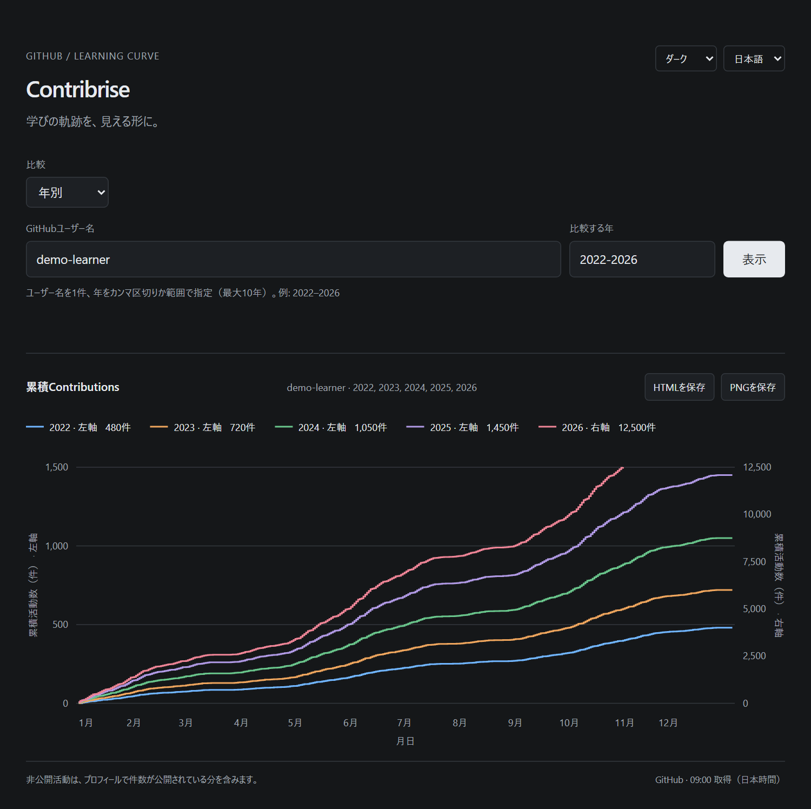
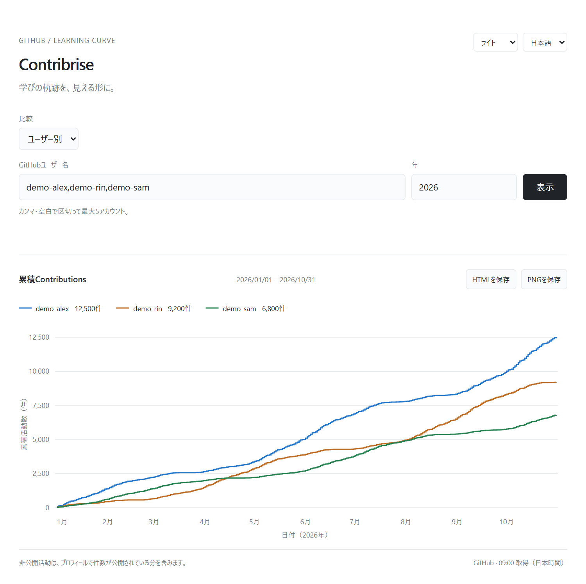

# Contribrise

**学びの軌跡を、見える形に。**

GitHubのContribution Calendarを、年初からの累積曲線に。自分の各年を重ねてペースの変化を振り返ったり、複数のアカウントを並べて見たりできるアプリです。

[English](README.md) · [すぐに使う](#すぐに使う) · [使い方](#使い方)



_ダークモードの年別比較・自動2軸表示とHTML／PNG保存。スクリーンショットのユーザー名とデータはすべて架空のサンプルです。_

## できること

- **自分の各年を比較。** 最大10年を、同じ月日で重ねて表示します。
- **活動数が大きく変わっても見やすく。** 自動2軸表示で、活動の少ない年の曲線も読み取れます。
- **複数のアカウントを比較。** 最大5人を並べ、カーソルやタップでその日の累積値を確認できます。
- **小さく、すぐ使える。** 日本語・英語、ライト／ダーク／システム配色、設定の保存、比較条件を復元できるURL。ビルドや追加パッケージは不要です。

活動数は、スキルや学習成果そのものを測る指標ではありません。能力を順位付けするためではなく、自分の習慣を振り返るために使います。

## すぐに使う

[Python 3.10以降](https://www.python.org/downloads/)と[GitHub CLI](https://cli.github.com/)をインストールして、次を実行します。

```sh
gh auth login
gh repo clone Hitoshi-Nakanishi/contribrise
cd contribrise
python src/contribrise/app.py --open
```

最初のコマンドはGitHub CLIへのログインです。ログイン済みなら省略できます。macOSやLinuxでPythonのコマンド名が`python3`の場合は、最後のコマンドを`python3 src/contribrise/app.py --open`にしてください。

ブラウザでアプリが開きます。Windowsでは、clone後に`start.cmd`をダブルクリックすることもできます。`pip install`、`npm install`、データベース、アプリへのトークン入力は不要です。

## 使い方

1. 「年別」か「ユーザー別」を選びます。
2. ユーザー名1件と比較する年、または複数のユーザー名と1年を入力します。年は`2022-2026`のような範囲でも、カンマ区切りでも指定できます。
3. 「表示」を押します。カーソルやタップで日ごとの累積値を確認し、凡例を押すと線の表示を切り替えられます。
4. 「HTMLを保存」で、表示中のページを1つの読み取り専用HTMLファイルに保存できます。チャート・表示中の線・言語・配色・累積値・取得時刻を含み、Contribriseを起動せずオフラインで開けます。スクリプトや認証情報は含みません。「PNGを保存」では、同じチャート・表示中の線・累積値・言語・配色を1枚の画像に保存できます。どちらもブラウザ内で生成します。



_ライトモードのユーザー別比較は同じスケールで表示します。表示中の画面をHTMLやPNGに保存できます。画面右上で言語と配色を切り替えられ、選んだ設定は保存されます。_

今年の線は取得済みの日付で止まります。うるう年でない年の2月29日など、該当するデータがない日はツールチップに「—」を表示します。比較URLにはユーザー名・比較モード・年が含まれ、Contribriseを使う別の人も同じ条件を復元できます。

<details>
<summary>自動2軸表示の仕組み</summary>

年別比較では、ゼロでない累積値を小さい順に並べ、隣り合う値に5倍以上の差がある場合に2軸にします。最も大きな比率の境目で分け、活動数の少ないグループを左軸、多いグループを右軸に表示します。規模が近い年は1軸で比較します。

両軸ともゼロから始まり、凡例とツールチップに各年が使う軸を表示します。線を非表示にしても軸の割り当ては変えません。左右の軸ではスケールが異なるため、値の比較には軸の目盛りとツールチップを使ってください。

</details>

## ローカル利用とプライバシー

- 既存のGitHub CLIログインを使い、GitHub GraphQL APIのContribution Calendarから直接取得します。結果はメモリー内に5分間キャッシュします。
- 非公開活動は、ログイン中のアカウントにGitHubが表示する件数を含みます。閲覧権限によって結果が異なる場合があります。[GitHubの集計条件](https://docs.github.com/en/account-and-profile/reference/profile-contributions-reference)も参照してください。
- アプリはこのPC内からの接続だけを受け付けます。認証情報はGitHub CLIが管理します。アクセス解析、外部スクリプト、活動履歴の保存はありません。
- ユーザー名・言語・配色はブラウザに保存します。ユーザー名と年は比較URLにも含まれます。

このリポジトリはローカルアプリのソース公開です。ホスティングされたサービスではなく、個人のGitHub認証情報を使ったまま公開Webサービスとして配信することには対応していません。

<details>
<summary>接続先と終了方法</summary>

通常の接続先は`http://127.0.0.1:8783`です。`--port`で変更でき、別のアプリが使用中の場合は空いているポートを選びます。

ブラウザを閉じても取得処理は待機します。終了を自分で操作する場合は、ターミナルから`python src/contribrise/app.py`で起動し、使い終わったらCtrl+Cを押します。

</details>

## 開発

Pythonパッケージは`src/contribrise`に置き、`app.py`がデータ取得と`static/`内のHTML・CSS・JavaScriptの配信を受け持ちます。チャートは標準のSVGで描画し、`theme.js`が画面の描画前に保存済みの配色を反映します。実行時に必要なのはPythonの標準ライブラリとGitHub CLIだけです。

ソースからは`python src/contribrise/app.py --open`、Windowsでは`start.cmd`でも起動できます。パッケージとコマンドをインストールする場合は、次を実行します。

```sh
python -m pip install .
contribrise --open
```

インストール後は`python -m contribrise --open`も使えます。

```sh
python -m unittest
```

## ライセンス

[MIT](LICENSE)
