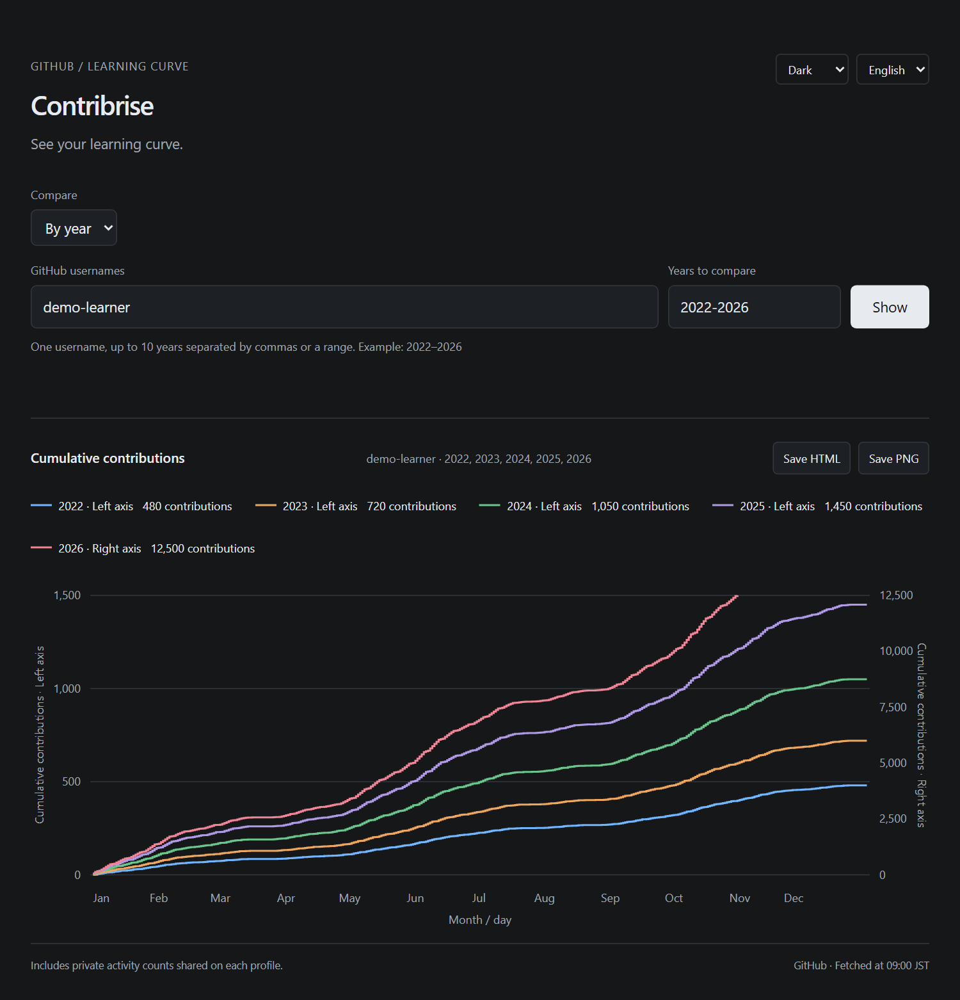
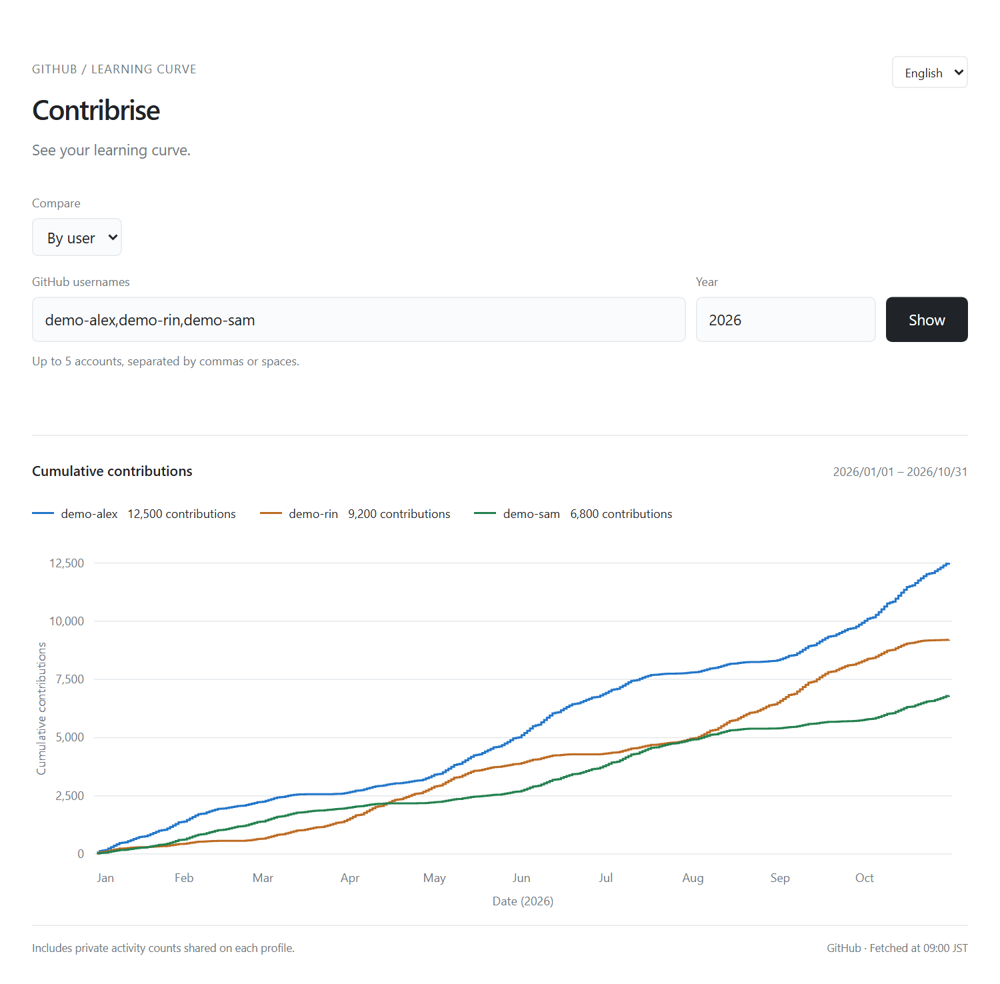

# Contribrise

**See your learning curve.**

Turn GitHub's contribution calendar into cumulative curves. Compare your years, see changes in your pace, or put a few accounts side by side.

[日本語](README.ja.md) · [Quick start](#quick-start) · [How to use](#how-to-use)



_Year-by-year comparison with automatic dual axes. All screenshots use fictional usernames and synthetic data._

## What you can do

- **Compare your years.** Overlay up to ten years on the same month/day axis.
- **See quiet and busy years clearly.** Automatic dual axes keep smaller curves visible when activity changes sharply.
- **Compare accounts.** Show up to five users together, with exact cumulative values on hover or tap.
- **Keep it simple.** English and Japanese, light/dark/system themes, remembered preferences, and URLs that restore a comparison. No build step or extra packages.

Contributions show activity, not skill or learning outcomes. Use the curves to reflect on your habits, not to rank ability.

## Quick start

Install [Python 3.10+](https://www.python.org/downloads/) and [GitHub CLI](https://cli.github.com/), then run:

```sh
gh auth login
gh repo clone Hitoshi-Nakanishi/contribrise
cd contribrise
python src/contribrise/app.py --open
```

The first command signs GitHub CLI in; skip it if you are already signed in. On macOS or Linux, use `python3` if your Python command is named that way.

The app opens in your browser. On Windows, you can also double-click `start.cmd` after cloning. There is no `pip install`, `npm install`, database, or token field in the app.

## How to use

1. Choose **By year** or **By user**.
2. Enter a username and years, or several usernames and one year. Ranges such as `2022-2026` and comma-separated years both work.
3. Click **Show**. Hover or tap for daily cumulative values; click a legend entry to hide or restore a line.
4. Click **Save snapshot** to download the current view as a single, read-only HTML file. It includes the chart, visible lines, language, theme, totals, and fetch time. Open it offline without running Contribrise; it contains no scripts or credentials.



_Account comparison on one shared scale. Switch between English and 日本語, or choose a light, dark, or system theme at the top right. Your theme is remembered._

The current year's line stops at the latest available date. Missing dates, including a leap day in a non-leap year, show a dash in the tooltip. Comparison URLs include the usernames, mode, and years, so another Contribrise user can restore the same view.

<details>
<summary>How automatic dual axes work</summary>

Yearly comparisons sort nonzero totals by size. If adjacent totals differ by at least five times, the largest qualifying gap separates the groups: smaller totals use the left axis, larger totals use the right. Similar totals share one axis.

Both axes start at zero. The legend and tooltip identify the axis for every year. Axis assignment stays stable when hiding lines. Curves on different axes have different scales; compare values using the labels and tooltip.

</details>

## Local use and privacy

- Data comes directly from GitHub's GraphQL contribution calendar through your existing GitHub CLI login. Results are cached in memory for five minutes.
- Private activity counts are included when GitHub exposes them to the signed-in account. Viewers with different access may see different counts. See [GitHub's counting rules](https://docs.github.com/en/account-and-profile/reference/profile-contributions-reference).
- The app runs on your PC and accepts local connections only. Credentials stay with GitHub CLI. There are no analytics, third-party scripts, or saved activity history.
- Usernames, language, and theme are saved in your browser. Usernames and years also appear in comparison URLs.

This repository publishes the source of a local app. It is not a hosted service and should not be deployed publicly with your GitHub credentials.

<details>
<summary>Port and stopping the app</summary>

The default address is `http://127.0.0.1:8783`. Set another port with `--port`; if the port is occupied by another app, Contribrise selects an available one.

The background process stays available after closing the browser. For an explicit stop control, run `python src/contribrise/app.py` in a terminal and press Ctrl+C when finished.

</details>

## Development

The Python package lives in `src/contribrise`. `app.py` fetches data and serves the HTML, CSS, and JavaScript in `static/`. Charts use native SVG; `theme.js` applies the saved theme before the page paints. Runtime dependencies are limited to Python's standard library and GitHub CLI.

Source checkout: run `python src/contribrise/app.py --open`, or double-click `start.cmd` on Windows. To install the package and command instead:

```sh
python -m pip install .
contribrise --open
```

The installed package also supports `python -m contribrise --open`.

```sh
python -m unittest
```

## License

[MIT](LICENSE)
